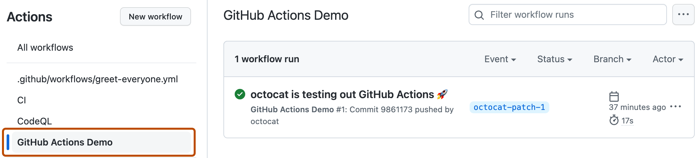
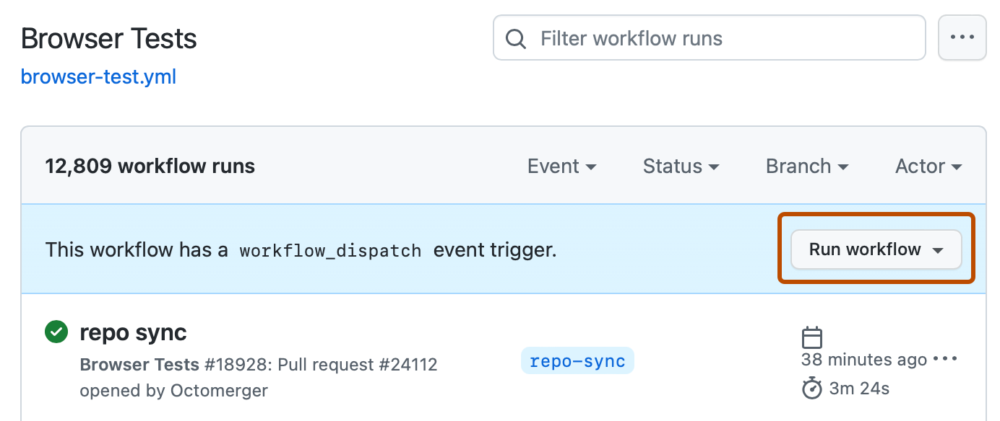

*(Target audience: Peter)*

# How to put a pumpkin photo on the website

This is the only set of instructions you need. Follow it from top to bottom, one step at a time. It takes about 10 minutes, and most of that is waiting.

If something looks wrong or you get stuck, you can **always** ask Connor for help.

---

## Part 1: Give the photo its name (on your laptop)

Rename the photo to the pumpkin's name, exactly as you want it to appear as the title on the website, for example `Alastor Mad Eye Moody.jpg`.

- Keep the `.jpg` at the end.
- Don't use a colon (`:`). Windows won't allow it anyway.

Don't shrink, crop or edit the photo. Use it exactly as it came off the camera or phone.

---

## Part 2: Upload the photo

1. Click this link. It opens the upload page in your web browser:

   ### 👉 [Upload page](https://github.com/jacklego/jacklego.github.io/upload/main/_inbox)

   - If you see a **Sign in** page, sign in to GitHub and then click the link again.
   - If you see **"404 – page not found"**, it means you aren't signed in. Look for **Sign in** in the top-right corner of the page, sign in, and click the link again.
2. In the middle of the page is a large box that says **Drag files here to add them to your repository**, with **choose your files** under it. Click **choose your files**.
3. A window opens that looks like the folder from Part 1. Find your renamed photo and double-click it.
4. Wait until the photo's name shows up in a list under the box. This can take a few seconds.
5. Scroll to the bottom of the page. You don't need to type anything in the boxes there. Click the green **Commit changes** button. ("Commit" is just GitHub's word for "save".)

---

## Part 3: Wait for the page to be built (about 2 minutes)

The website now makes a page for your photo on its own. You only need to wait until it's done.

1. Click this link:

   ### 👉 [Progress page](https://github.com/jacklego/jacklego.github.io/actions)

2. The top line of the list should say **Ingest carvings** in small grey text. To its left is a small round symbol:
    - **yellow circle**: still working. Wait a minute, then press **F5** to refresh the page.
    - **green circle with a check mark**: done. Go on to Part 4. (If this is the **first pumpkin of a new year**, do the *New year only* step below first.)
    - **red circle with an X**: it failed. Your photo is still saved, but its page wasn't built. You can ask Connor about it.

   When it's finished, it looks like this (the names on your screen will be different):

   

---

## New year only: start the new season

**Skip this unless this is the first pumpkin of a new year.** Until you do this step, *This Year's Patch* keeps showing last year's pumpkins, and the new year's pumpkins stay hidden. You only do it once a year. Do it after Part 3 has finished, because it needs the new year's first pumpkin to already be there.

These steps use 2027 and a made-up theme, *Star Trek Villains*. Use your own year and theme.

1. Click this link. It opens the settings file that says which year is "this year":

   ### 👉 [Edit the year settings](https://github.com/jacklego/jacklego.github.io/edit/main/_variables.yml)

2. You'll see a short list of lines with numbers down the left side. Find the line that starts with `currentYear:`, like this:

   ```
   currentYear: 2026
   ```

   Click just after the year, press **Backspace** four times to delete it, and type the new year. It should now read:

   ```
   currentYear: 2027
   ```

   Keep the single space after the colon.
3. Scroll to the very last line of the file. It's last year's theme, something like:

   ```
     2026: Harry Potter Villains
   ```

   Click at the very end of that line and press **Enter** to start a new line under it.
4. On the new line, type the new year, a colon, a space, and the theme:

   ```
     2026: Harry Potter Villains
     2027: Star Trek Villains
   ```

   - The new line has to start in the same column as the line above it, with **two spaces** before the year. GitHub usually puts those two spaces in for you when you press Enter. Check that the year lines up exactly under the one above, and add or delete spaces until it does.
   - Don't put a colon (`:`) or a `#` inside the theme itself. Use a dash instead of a colon, like `Star Trek - The Villains`.
   - Don't change any of the other lines.
5. In the top-right corner of the page, click the green **Commit changes...** button. A small box pops up. Don't change anything in it, and click the green **Commit changes** button at the bottom of the box.
6. Click this link and wait for the top line, which says **Go live** in small grey text, to get a green check mark. It usually takes under a minute. Press **F5** to refresh.

   ### 👉 [Progress page](https://github.com/jacklego/jacklego.github.io/actions)

   A **red X** means it failed. You can ask Connor about it.
7. Go on to Part 4.

---

## Part 4: Put it on the website

This is the step that makes the new page show up for everyone.

1. Click this link:

   ### 👉 [Publish page](https://github.com/jacklego/jacklego.github.io/actions/workflows/publish.yml)

2. On the right side of the page there's a blue strip with a **Run workflow** button in it. Click **Run workflow**:

   

3. A small box opens under it. Don't change anything in it. Click the green **Run workflow** button at the bottom of that box.
4. After a few seconds a new line appears at the top of the list with a yellow circle next to it. If it doesn't, press **F5** to refresh the page.
5. Wait until that circle turns into a **green check mark**. This usually takes 3 to 5 minutes. Press **F5** every minute or so to check. A **red X** means it failed, and the website stays as it was. You can ask Connor about it.
6. Wait **two more minutes**. The website takes a moment to update after the check mark turns green.

---

## Part 5: Look at it

1. Go to **[peterspumpkinpatch.org](https://peterspumpkinpatch.org)**.
2. At the top of the page, click **This Year's Patch**. Your pumpkin is on that page.
3. If it isn't there yet, wait two minutes and press **F5**.

You're done. Connor gets an automatic email saying a new pumpkin went up, and he'll tidy up anything that needs it, like the categories or the wording. You don't have to do anything about that.

---

## When you've uploaded them all: put them in order

New pumpkins go at the end of the page, in the order you uploaded them. Once all of this year's pumpkins are up, you can rearrange them. You can do this as often as you like.

1. Click this link. It opens the list of this year's pumpkins, top to bottom in the order they appear on the page:

   ### 👉 [Edit this year's order](https://github.com/jacklego/jacklego.github.io/edit/main/pumpkins/2026/order.txt)

2. Ignore the lines at the top that start with `#`. Below them is one pumpkin per line.
3. Move the lines into the order you want. The easiest way: click anywhere on a line, then hold **Alt** and press the **↑** or **↓** arrow key to move that line up or down. (Cut and paste works too.)
   - Don't change the names themselves, only move them.
   - Don't add numbers. The order of the lines *is* the order.
4. In the top-right corner of the page, click the green **Commit changes...** button. A small box pops up. Don't change anything in it, and click the green **Commit changes** button at the bottom of the box.
5. Click this link and wait for the top line, which says **Reorder carvings** in small grey text, to get a green check mark. It usually takes under a minute. Press **F5** to refresh.

   ### 👉 [Progress page](https://github.com/jacklego/jacklego.github.io/actions)

   A **red X** means it failed. You can ask Connor about it.
6. Do **Part 4** again to put the new order on the website, then check it as in **Part 5**.

If you misspell a name or delete a line by accident, nothing breaks: that pumpkin just goes to the end of the page, and it's back in the list next time you open it.

---

## Replace a pumpkin's photo with a different one

Use this when a pumpkin is already on the website but you have a better photo of it. Everything else about the pumpkin stays the same: its name, its place on the page, and anything Connor has tidied up.

1. Rename the new photo to **exactly the same name** as the pumpkin has on the website, for example `Dementor.jpg`. Capitals don't matter, but spelling does.
2. Upload it exactly as in **Part 2**. GitHub may say a file with that name already exists. That's fine; the new one replaces it.
   - **Don't delete anything first.** Deleting the pumpkin and uploading it again loses Connor's tidying-up and moves it to the end of the page.
3. Wait for **Ingest carvings** to get its green check mark, as in **Part 3**.
4. Do **Part 4** to put the new photo on the website.

If the name doesn't match, you'll get a second pumpkin instead of a new photo. Nothing is lost: remove the extra one with the steps below, or ask Connor.

---

## Remove a pumpkin completely

This takes the pumpkin, its photo, and its page off the website.

1. Click this link:

   ### 👉 [Remove a pumpkin](https://github.com/jacklego/jacklego.github.io/actions/workflows/remove.yml)

2. On the right side of the page there's a blue strip with a **Run workflow** button in it, just like in Part 4. Click **Run workflow**.
3. A small box opens with a space labeled **The pumpkin's name**. Type the name exactly as the website shows it, for example `Alastor Mad Eye Moody`. Capitals don't matter.
   - If more than one pumpkin has that name, add the year after it, like `Darth Vader 2020`.
   - Or paste the pumpkin's web address instead of its name.
4. Click the green **Run workflow** button at the bottom of the box.
5. Wait for the new line at the top of the list to get a **green check mark**. It usually takes under a minute. Press **F5** to refresh.
   - A **red X** means it couldn't find that pumpkin, or found more than one with that name, and **nothing was removed**. Click on the line to see the reason, then try again with a different name, or ask Connor.
6. Do **Part 4** to take it off the website.

If you remove the wrong pumpkin, Connor can bring it back. Nothing is ever truly lost.

---

## If you get lost

- **Clicking a link above shows a page you don't recognize.** Close it and click the link in these instructions again. You can always start over from the beginning of the Part you were on.
- **You want to add two photos of the same pumpkin.** Name them `Frankenstein.jpg` and `Frankenstein 2.jpg`, and pick both in Part 2, step 3: click the first, then hold **Ctrl** and click the second.

---

<sub>Screenshots are from [GitHub Docs](https://docs.github.com/), © GitHub, Inc., used under [CC BY 4.0](https://creativecommons.org/licenses/by/4.0/). They come from GitHub's own example project, so the names in them won't match what you see.</sub>
